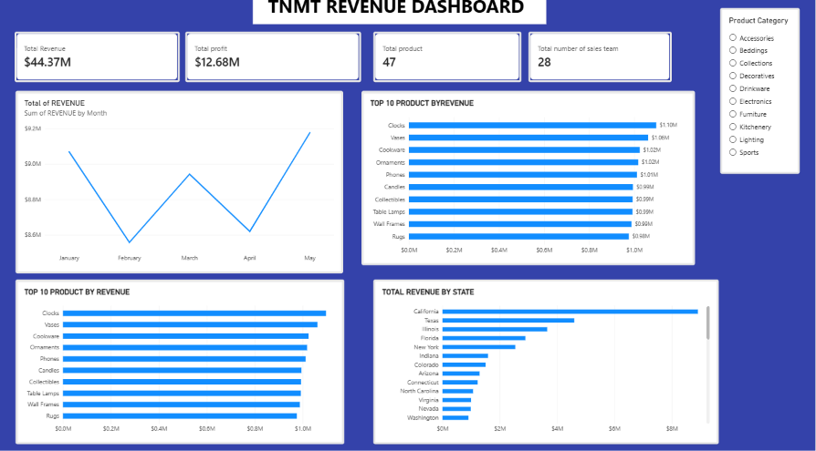

# 📊 TNMT Revenue Dashboard | Power BI


## 📌 Project Overview

The **TNMT Revenue Dashboard** is an interactive Business Intelligence project developed using Microsoft Power BI to analyze revenue performance, profitability, product sales, and geographical revenue distribution.

The objective of this project was to transform business sales data into meaningful, actionable insights through interactive visualizations and KPI reporting.

The dashboard provides a consolidated view of business performance, enabling stakeholders to monitor key financial indicators, identify top-performing products, analyze monthly revenue trends, and understand revenue contributions across different states.

## 🖥️ Dashboard Preview



*TNMT Revenue Dashboard – Interactive Power BI Report*

## 🎯 Business Objectives

- Monitor overall revenue and profit performance.
- Identify the highest revenue-generating products.
- Analyze monthly revenue trends and fluctuations.
- Evaluate revenue contributions across different states.
- Provide interactive exploration of product category performance.
- Support data-driven business decisions through visual reporting.

## 📈 Key Performance Indicators (KPIs)

| KPI | Result |
|---|---:|
| Total Revenue | **$44.37M** |
| Total Profit | **$12.68M** |
| Total Products | **47** |
| Total Sales Team | **28** |

## 📊 Dashboard Features & Visualizations

### 1. Monthly Revenue Analysis
- Tracks revenue performance from January to May.
- Highlights monthly revenue fluctuations.
- Helps identify revenue peaks and declines.

### 2. Top 10 Products by Revenue
- Ranks the top 10 revenue-generating products.
- Identifies products contributing significantly to total revenue.
- Makes product performance comparisons easier.

### 3. Revenue by Product
- Provides a comparative view of revenue across leading products.
- Highlights the strongest product revenue contributors.

### 4. Revenue by State
- Visualizes revenue distribution across different geographical locations.
- Identifies high-performing states.
- Supports geographical performance evaluation.

### 5. Interactive Product Category Slicer
- Allows users to filter dashboard insights by product category.
- Supports dynamic exploration of business performance.
- Makes the dashboard flexible and user-friendly.

## 💡 Key Business Insights

- **Revenue Performance:** The business generated $44.37M in total revenue.
- **Profitability:** Total profit stands at $12.68M.
- **Product Performance:** The top 10 product visualization highlights leading revenue contributors.
- **Monthly Trends:** Revenue fluctuates across the five months analyzed, with May recording the highest visible monthly revenue.
- **Geographical Performance:** California leads the displayed state revenue ranking.
- **Product Segmentation:** Category filtering allows users to investigate performance across different product segments.

## 🛠️ Tools & Technologies

- **Microsoft Power BI** – Dashboard development and data visualization.
- **Power Query** – Data preparation and transformation.
- **DAX** – KPI calculations and analytical measures.
- **Data Visualization** – Interactive charts, cards, and slicers.
- **Business Intelligence** – Performance monitoring and reporting.

## 🧠 Skills Demonstrated

- Data analysis and interpretation.
- Data cleaning and transformation.
- Data modeling and analytical reporting.
- DAX measures and KPI development.
- Interactive dashboard design.
- Business performance analysis.
- Data storytelling and insight communication.
- Translating business requirements into visual solutions.

## 📂 Project Structure

```text
TNMT-Revenue-Dashboard/
│
├── README.md
│
├── images/
│   └── TNMT_DASHBOARD.png
│
├── TNMT_Revenue_Dashboard.pbix
│
└── data/
    └── Source_Dataset.xlsx
```

## 🚀 How to Explore This Project

1. Clone or download this repository.
2. Install Microsoft Power BI Desktop.
3. Open the `.pbix` file in Power BI Desktop.
4. Interact with the dashboard using the product category slicer.
5. Explore revenue trends, product performance, and geographical insights.

## 📌 Project Outcome

This project demonstrates how Power BI can be used to convert business data into an interactive reporting solution.

By combining KPI monitoring, product analysis, monthly revenue trends, and geographical performance visualization, the TNMT Revenue Dashboard provides a clear overview of business performance in one centralized report.

It reflects my ability to apply data analytics and business intelligence techniques to business reporting scenarios.

## 👨‍💻 About Me

I am passionate about Data Analytics and Business Intelligence, with an interest in using data to uncover insights, solve business problems, and support strategic decision-making.

I continuously develop my analytical and technical skills through practical projects involving data visualization, reporting, and business intelligence tools.

**My goal is to turn data into insights that drive business growth and better decisions.**

## 🤝 Let's Connect

I am open to connecting with recruiters, hiring managers, data professionals, and organizations looking for individuals passionate about data analytics and business intelligence.

Thank you for taking the time to explore my project!
